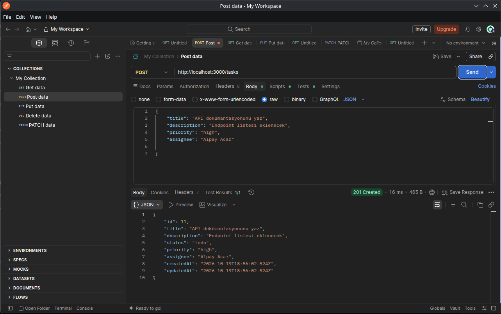
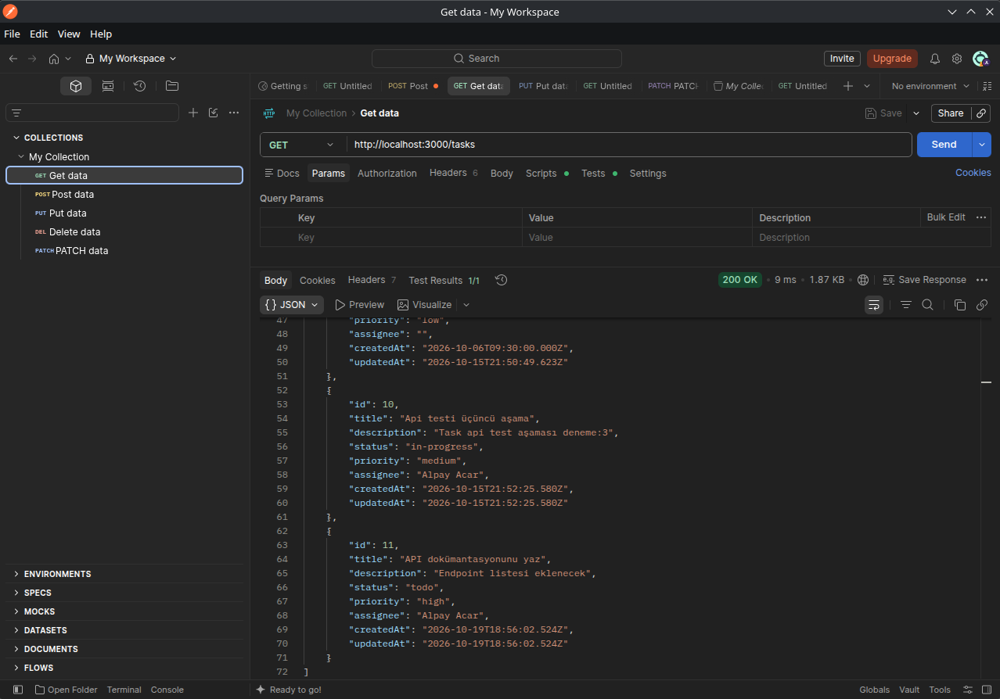
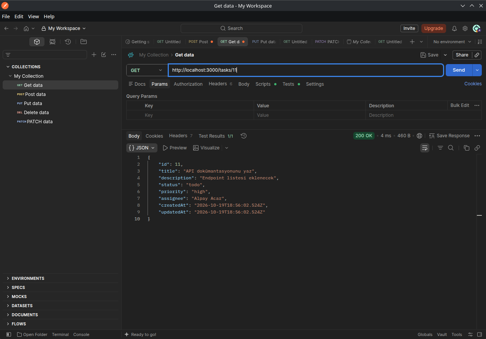
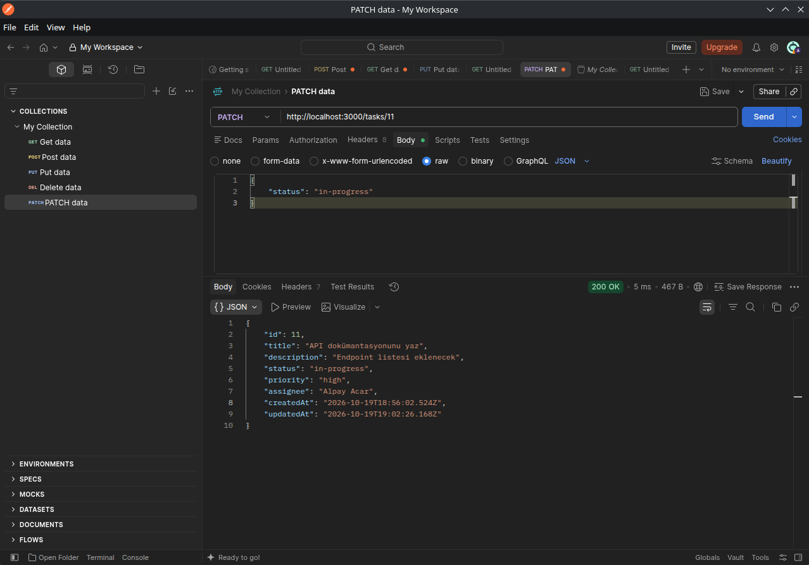
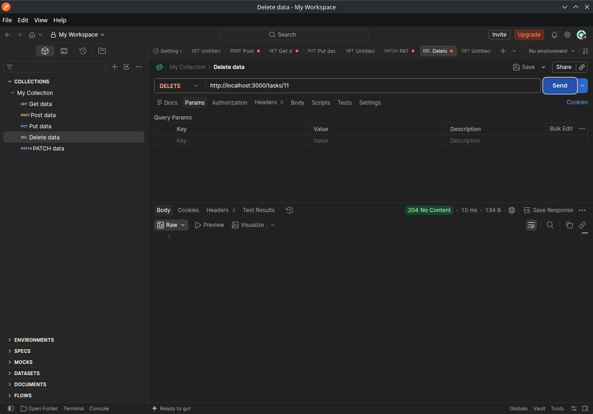
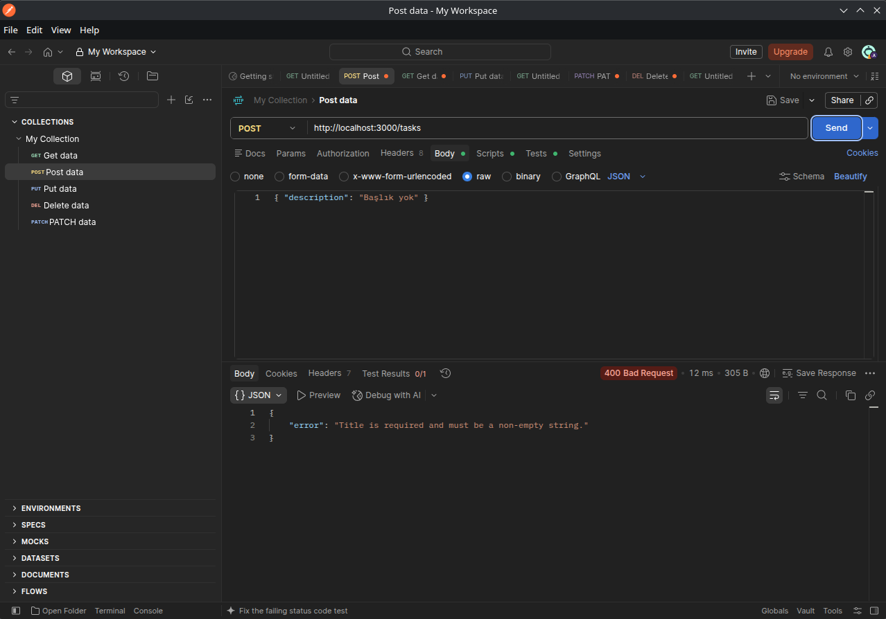
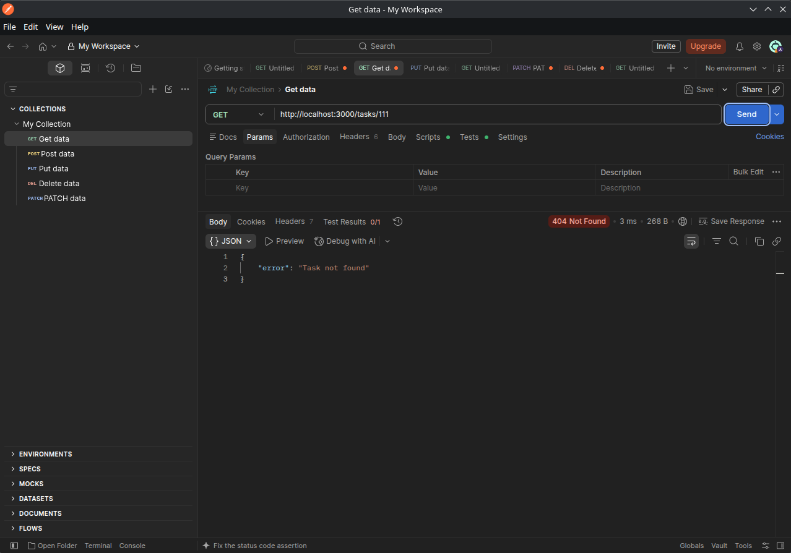
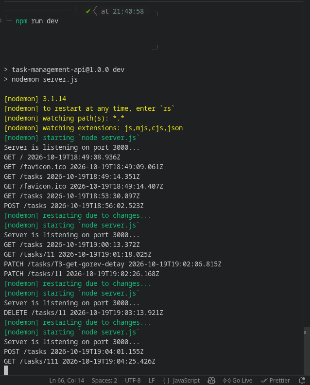

# Görev ve Proje Yönetim Sistemi API'si

Node.js ve Express ile geliştirilmiş, REST mimarisine uygun bir görev yönetim API'sidir. Bir yazılım ekibinin görevlerini oluşturmasını, listelemesini, güncellemesini ve silmesini sağlar. Görevlere çalışan atanabilir, durum ve öncelik bilgisi tutulur. Tüm istekler bir logger middleware ile kayıt altına alınır.

## Özellikler

- Görev ekleme, listeleme, detay görüntüleme, güncelleme ve silme (CRUD)
- Durum takibi: `todo`, `in-progress`, `done`
- Öncelik yönetimi: `low`, `medium`, `high`
- Görevlere çalışan atama (isim soyisim, boşsa görev atanmamış)
- İstek doğrulama ve anlamlı hata yanıtları
- Her istek için metot, endpoint ve zaman damgası loglama
- Veriyi JSON dosyasında saklama (veritabanı gerektirmez)
- Silinen görevlerin ID'leri tekrar kullanılmaz

## Teknolojiler

- Node.js
- Express.js
- nodemon (geliştirme ortamı)

## Gereksinimler

- Node.js 18 veya üzeri
- npm
- API'yi test etmek için Postman (isteğe bağlı)

## Kurulum

```bash
git clone https://github.com/alpayacr0/task-management-api
cd task-management-api
npm install
```

## Çalıştırma

Normal çalıştırma:

```bash
npm start
```

Geliştirme modu (dosya değişince otomatik yeniden başlar):

```bash
npm run dev
```

Sunucu varsayılan olarak `http://localhost:3000` adresinde çalışır.

## Proje Yapısı

```
task-management-api/
├── app.js                    # Express uygulaması, middleware ve route bağlantıları
├── server.js                 # Sunucuyu başlatır, portu dinler
├── routes/
│   └── tasks.js              # Görev endpoint'leri
├── middleware/
│   ├── logger.js             # İstek loglama
│   ├── validation.js         # POST doğrulaması
│   └── validateUpdate.js     # PATCH doğrulaması
├── utils/
│   └── file.js               # JSON dosyası okuma/yazma
├── data/
│   └── tasks.json            # Görev verisi ve ID sayacı
├── screenshots/              # Postman test ekran görüntüleri
├── package.json
└── README.md
```

## API Endpoint'leri

Temel yol: `/tasks`

| Metot  | Endpoint     | Açıklama                                | Başarılı yanıt |
| ------ | ------------ | --------------------------------------- | -------------- |
| GET    | `/tasks`     | Tüm görevleri listeler                  | 200            |
| GET    | `/tasks/:id` | Belirli bir görevi getirir              | 200            |
| POST   | `/tasks`     | Yeni görev oluşturur                    | 201            |
| PATCH  | `/tasks/:id` | Görevin gönderilen alanlarını günceller | 200            |
| DELETE | `/tasks/:id` | Görevi siler                            | 204            |

### Hata yanıtları

| Durum kodu | Ne zaman                                                              |
| ---------- | --------------------------------------------------------------------- |
| 400        | Geçersiz ya da eksik alan (ör. boş `title`, izin verilmeyen `status`) |
| 404        | Görev bulunamadı ya da tanımsız yol                                   |
| 500        | Veri dosyasına yazılamadı                                             |

Doğrulama ve bulunamadı hataları `{ "error": "..." }` biçiminde döner.

## Veri Modeli

| Alan        | Tip                | Zorunlu  | Açıklama                                          |
| ----------- | ------------------ | -------- | ------------------------------------------------- |
| id          | sayı               | otomatik | Sunucu üretir, silinen ID'ler tekrar kullanılmaz  |
| title       | string             | evet     | Boş olamaz                                        |
| description | string             | hayır    | Varsayılan: boş string                            |
| status      | string             | hayır    | `todo`, `in-progress`, `done`. Varsayılan: `todo` |
| priority    | string             | hayır    | `low`, `medium`, `high`. Varsayılan: `medium`     |
| assignee    | string             | hayır    | İsim soyisim. Varsayılan: boş string (atanmamış)  |
| createdAt   | string (ISO tarih) | otomatik | Oluşturulma zamanı                                |
| updatedAt   | string (ISO tarih) | otomatik | Son güncelleme zamanı                             |

ID üretimi için `data/tasks.json` içinde kayıtlardan bağımsız bir `lastId` sayacı tutulur. Son görev silinse bile yeni görev, silinen ID'yi almaz.

## Örnek Kullanım

### Görev oluşturma

`POST /tasks`

```json
{
  "title": "API dokümantasyonunu yaz",
  "description": "Endpoint listesi eklenecek",
  "priority": "high",
  "assignee": "Ayşe Yılmaz"
}
```

Yanıt (`201 Created`):

```json
{
  "id": 9,
  "title": "API dokümantasyonunu yaz",
  "description": "Endpoint listesi eklenecek",
  "status": "todo",
  "priority": "high",
  "assignee": "Ayşe Yılmaz",
  "createdAt": "2026-10-19T10:00:00.000Z",
  "updatedAt": "2026-10-19T10:00:00.000Z"
}
```

### Görev güncelleme

`PATCH /tasks/9`

```json
{
  "status": "in-progress"
}
```

Sadece gönderilen alanlar değişir, diğerleri korunur.

### Atamayı kaldırma

`PATCH /tasks/9`

```json
{
  "assignee": ""
}
```

## Loglama

Her istek konsola zaman damgası, metot ve URL ile yazılır:

```
[2026-10-19T10:00:00.000Z] GET /tasks/5
```

## Testler

Tüm CRUD endpoint'leri Postman ile test edilmiştir.

### Görev ekleme (POST)



### Görev listeleme (GET)



### Görev detayı (GET)



### Görev güncelleme (PATCH)



### Görev silme (DELETE)



### Hata: başlıksız görev (400)



### Hata: olmayan görev (404)



### Logger çıktısı



## Bilinen Sınırlamalar

- Veri JSON dosyasında tutulur, eşzamanlı yoğun kullanım için tasarlanmamıştır.
- Kimlik doğrulama yoktur.
- Filtreleme ve raporlama endpoint'leri henüz eklenmemiştir.

## Geliştirici

Alpay Acar
